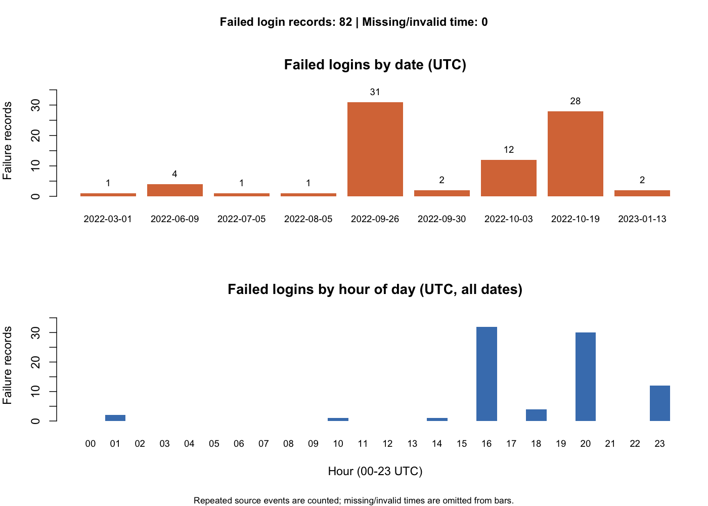

# CloudTrail 로그인 기록 추출과 실패 시각화 — 프로젝트 상세 설명

## 1. 무엇을 만드는 프로젝트인가요?

CloudTrail JSON 파일에서 AWS 콘솔 로그인 이벤트인 `ConsoleLogin`만 찾아 표로 정리하고, 실패 기록을 날짜별·시간대별 막대그래프로 보여 주는 R 프로젝트입니다. 사용자는 파일 경로를 입력하고, 프로그램은 CSV와 PNG를 만듭니다.

핵심 코드는 세 파일, 주석·빈 줄 포함 **135줄**입니다. `login_records.R` 73줄, `failure_charts.R` 48줄, `run_analysis.R` 14줄이며 테스트와 설명 문서는 별도입니다.

이 프로젝트에서 '실패 탐지'는 원본의 `responseElements$ConsoleLogin` 값이 `Failure`인 기록을 찾아 집계한다는 뜻입니다. 비밀번호 추측이나 계정 탈취를 판정하는 모델은 없습니다. 실패 기록만으로 공격이라고 확정할 수 없습니다.

AWS의 로그인 이벤트 구조는 [공식 Console sign-in 문서](https://docs.aws.amazon.com/awscloudtrail/latest/userguide/cloudtrail-event-reference-aws-console-sign-in-events.html)를 참고했습니다.

## 2. 전체 실행 흐름

```text
사용자가 준비한 JSON 또는 NDJSON 파일
  ↓ read_events(path): 파일을 읽고 JSON을 해석
  ↓ event_list(x): 서로 다른 문서 포장을 이벤트 목록으로 통일
이벤트 여러 개를 담은 list
  ↓ login_records(events): ConsoleLogin만 선택하고 한 행씩 변환
time / user / ip / result 네 열을 가진 data.frame
  ├─ write.csv(): 로그인 성공과 실패를 모두 CSV로 저장
  └─ failure_counts(records): 실패 행만 선택해 UTC 기준 집계
        ↓ plot_login_failures(records): 날짜별·시간대별 그래프
        ├─ RStudio Plots 창에 표시
        └─ save_failure_chart(records, path): PNG 파일로 저장
```

`run_analysis.R`은 이 함수들을 순서대로 호출하는 실행 파일입니다. 계산 알고리즘을 다시 만드는 파일이 아니라, 입력부터 저장까지 연결하는 역할입니다.

## 3. 실행하기 전에 준비할 것

R, RStudio, `jsonlite` 패키지가 필요합니다. 그래프에는 R 기본 기능을 사용하므로 ggplot2는 필요하지 않습니다. AWS 접속이나 인증키 없이 이미 받은 파일을 분석합니다.

RStudio에서 `cloudtrail-analysis` 폴더를 작업 폴더로 선택하세요. 작업 폴더는 상대 경로를 해석하는 출발점입니다. 다음 명령으로 현재 위치와 파일 목록을 확인할 수 있습니다.

```r
getwd()
list.files()
install.packages("jsonlite")  # 처음 한 번 설치
```

`list.files()` 결과에 `login_records.R`와 `failure_charts.R`가 보여야 아래 코드를 그대로 실행할 수 있습니다. 입력 로그는 직접 준비합니다. 예를 들어 폴더 안에 `data` 폴더를 만들고 `logs.json`이라는 이름으로 저장합니다. 아래 경로는 이 배치를 가정한 예시입니다.

### RStudio에서 실행

Console에 아래 명령을 순서대로 실행하세요. 함수 파일의 Source만 눌렀을 때는 함수가 준비될 뿐, 데이터 읽기와 그래프 그리기가 자동 실행되지는 않습니다.

```r
source("login_records.R")
source("failure_charts.R")
events <- read_events("data/logs.json")
records <- login_records(events)
View(records)
table(records$result, useNA = "ifany")
plot_login_failures(records)
save_failure_chart(records, "output/login_failures.png")
```

`View(records)`는 표를 열고, `plot_login_failures(records)`는 Plots 창에 그림을 그립니다. `save_failure_chart()`는 PNG 저장이 목적이므로 이 함수만 실행해서는 Plots 창 표시를 보장하지 않습니다.

### CSV와 PNG를 함께 저장

프로젝트 폴더의 터미널에서 다음 명령을 실행합니다.

```sh
Rscript run_analysis.R data/logs.json output
```

결과는 `output/login_records.csv`, `output/login_failures.png`입니다. 추출만 하려면 `Rscript login_records.R data/logs.json output/login_records.csv`를 실행합니다. 입력과 출력에 서로 다른 경로를 사용하세요. 같은 출력 경로에 기존 결과가 있으면 덮어씁니다.

## 4. 입력이 표로 바뀌는 예시

다음은 실제 수집 기록이 아닌, 구조를 설명하기 위한 가상 예시입니다. IP도 문서 설명용 주소입니다.

```json
{
  "Records": [
    {
      "eventName": "ConsoleLogin",
      "eventTime": "2026-11-01T09:15:00Z",
      "userIdentity": {"userName": "demo-user"},
      "sourceIPAddress": "192.0.2.10",
      "responseElements": {"ConsoleLogin": "Failure"}
    }
  ]
}
```

변환 결과는 다음과 같습니다.

| time | user | ip | result |
| --- | --- | --- | --- |
| 2026-11-01T09:15:00Z | demo-user | 192.0.2.10 | Failure |

같은 파일에 다른 API 이벤트가 있어도 `eventName`이 `ConsoleLogin`과 정확히 일치하지 않으면 제외합니다. 성공 로그인은 표와 CSV에는 남기고 실패 그래프에서는 제외합니다.

## 5. x, lines, parsed, item에는 무엇이 들어가나요?

매개변수는 함수가 호출될 때 외부에서 받는 값의 이름입니다. 지역변수는 함수가 실행되는 도중 내부에서 만든 값의 이름입니다. `x`는 두 함수에서 서로 다른 용도로 쓰입니다. 이름이 같다고 같은 저장 공간인 것은 아닙니다.

| 이름 | 구분 | 담기는 데이터 | 예시 또는 역할 |
| --- | --- | --- | --- |
| path | 매개변수 | 파일 경로 문자열 하나 | read_events에서는 입력 JSON, save_failure_chart에서는 출력 PNG 경로 |
| x in text_value | 매개변수 | 원본 필드 값 또는 NULL | demo-user, Failure 또는 누락된 필드 |
| x in event_list | 매개변수 | 해석된 JSON list | Records가 있는 문서 또는 이벤트 배열·단일 이벤트 |
| lines | 지역변수 | 줄별 문자열 character 벡터 | 파일이 세 줄이면 처음에는 문자열 세 개 |
| parsed | 지역변수 | 파일 전체를 해석한 list 또는 NULL | 전체 JSON 해석 성공 시 객체, 실패 시 NULL |
| i | 반복변수 | 현재 처리 중인 줄의 번호 | R 인덱스는 1부터 시작 |
| item | 지역변수 | 현재 한 줄을 JSON으로 해석한 객체 | NDJSON 한 줄에 들어 있는 이벤트 |
| result in read_events | 지역변수 | 줄마다 얻은 이벤트를 누적한 list | 문자열 Success/Failure와는 다른 변수 |
| events | 매개변수 | 이벤트 객체들을 담은 list | list(event1, event2, ...) |
| e | 익명함수 매개변수 | events에서 꺼낸 이벤트 한 개 | e$eventName으로 이벤트 이름 조회 |
| selected | 지역변수 | 로그인 이벤트만 남긴 list | 일반 API 이벤트는 없음 |
| rows | 지역변수 | 한 행짜리 data.frame들의 list | 이후 rbind로 하나의 표로 연결 |
| records | 매개변수·변수 | 네 열을 가진 data.frame | time, user, ip, result |
| times / valid | 지역변수 | POSIXct 시간 벡터 | valid는 시각 해석에 성공한 값만 포함 |
| daily / hourly | 지역변수 | 빈도표 table | 날짜별 횟수 / 00~23시별 횟수 |
| counts | 지역변수 | 네 항목을 가진 list | total, invalid_time, daily, hourly |

`lines[[i]]`는 i번째 줄의 문자열 하나를 꺼냅니다. `e$userIdentity$userName`은 이벤트 안의 userIdentity 안에 있는 userName을 꺼냅니다. 중첩 JSON의 경로를 따라간다고 이해하면 됩니다.

## 6. login_records.R — 읽기와 로그인 추출

### text_value(x): 필드 한 개를 문자열로 통일

`is.null(x)`는 값 자체가 없는지 검사하고, `length(x) == 0`은 원소가 없는지 검사합니다. 둘 중 하나면 문자열형 결측값 `NA_character_`를 반환합니다. 값이 있으면 `x[[1]]`로 첫 원소를 꺼내 `as.character()`로 문자열로 바꿉니다.

이렇게 해야 사용자명이나 IP가 빠진 이벤트도 표 한 행을 유지할 수 있습니다. `NULL`은 값 없음, `NA`는 표 안의 빠진 값, `""`는 길이 0인 문자열 값입니다. 서로 같은 개념이 아닙니다.

### event_list(x): 문서 포장 통일

1. `is.list(x)`가 아니면 처리할 수 없는 구조이므로 `stop()`으로 중단합니다.
2. `x$Records`가 있으면 그 안에 든 이벤트 목록을 꺼냅니다.
3. `x$eventName`이 있으면 단일 이벤트로 보고 `list(x)`로 한 번 감쌉니다.
4. 그 밖에는 이미 이벤트 배열인 것으로 보고 `x`를 반환합니다.

한 개의 이벤트도 여러 이벤트와 같은 반복 처리 코드를 쓸 수 있게 만드는 단계입니다. 모든 이벤트의 필드를 완전히 검사하는 스키마 검증기는 아닙니다.

### read_events(path): 파일 내용을 R 객체로 해석

1. `readLines()`가 UTF-8 파일을 줄별 문자열로 읽습니다. 아직 JSON 객체가 아니라 글자입니다.
2. `trimws()`는 공백을 제거한 검사값을 만들고, `nzchar()`는 글자가 남아 있는지 확인합니다. 이 조건으로 빈 줄을 제외합니다. 저장한 원문 전체를 trim하는 코드는 아닙니다.
3. 내용이 비었으면 `list()`를 반환합니다.
4. `paste(lines, collapse = "\n")`로 줄들을 문서 하나로 합친 뒤 `fromJSON(..., simplifyVector = FALSE)`로 해석합니다. simplifyVector=FALSE는 객체·배열을 list 중심 구조로 유지합니다.
5. `tryCatch()`에서 전체 해석이 실패하면 오류를 즉시 종료하지 않고 `parsed <- NULL`로 바꿔 다른 읽기 방식을 시도합니다.
6. 전체 해석이 성공하면 `event_list(parsed)`로 포장을 통일한 결과를 반환합니다.
7. 실패했으면 `for (i in seq_along(lines))`로 각 줄을 해석합니다. 이것이 한 줄에 JSON 하나가 들어 있는 NDJSON 처리입니다.
8. 해석한 `item`을 `event_list(item)`으로 통일한 뒤 `c()`로 result 목록 뒤에 붙입니다.
9. 잘못된 줄은 `stop(sprintf(...))`로 위치를 알리고 중단합니다. 일부 줄만 조용히 버리지는 않습니다.

오류의 줄 번호는 빈 줄을 제거한 이후의 번호입니다. 원본 파일의 물리적인 줄 번호와 다를 수 있습니다.

### login_records(events): 한 이벤트를 한 행으로

```r
selected <- Filter(function(e) is.list(e) &&
  identical(e$eventName, "ConsoleLogin"), events)
```

`Filter()`는 조건이 TRUE인 원소만 남깁니다. `function(e)`는 잠깐 사용할 이름 없는 함수이며 이벤트 한 개를 받습니다. `&&`는 왼쪽 조건이 FALSE이면 오른쪽을 평가하지 않으므로, list가 아닌 원소에 `$eventName`을 바로 적용하지 않게 합니다. `identical()`은 대소문자까지 정확히 일치하는지 확인합니다.

`lapply(selected, function(e) {...})`는 각 로그인 이벤트에 같은 작업을 하고 결과를 list로 모읍니다. 사용자명은 userName을 우선 사용하고 NA일 때만 ARN으로 대체합니다. data.frame()은 네 값을 네 열의 한 행으로 만듭니다. `stringsAsFactors = FALSE`는 문자열을 범주형 factor로 자동 변환하지 않도록 명시합니다.

`do.call(rbind, rows)`는 한 행짜리 표들을 세로로 합칩니다. `order(output$time, na.last = TRUE)`는 시간 문자열을 정렬할 행 번호를 만듭니다. `output[행번호, , drop = FALSE]`에서 빈 열 자리는 모든 열을 뜻하고, drop=FALSE는 한 행이 남아도 data.frame 모양을 유지합니다.

현재 정렬은 시간 자료형으로 변환한 정렬이 아니라 원본 문자열 정렬입니다. 동일한 UTC ISO 표현을 전제로 하며 다른 오프셋·표현이 섞이면 정확한 시간순을 보장하지 않습니다.

### 파일 마지막 실행 구문

`if (sys.nframe() == 0)`은 일반적인 Rscript 직접 실행 때만 아래 저장 작업을 수행합니다. RStudio에서 source()로 불러올 때는 함수들을 준비하고 이 부분을 건너뜁니다.

`commandArgs(trailingOnly = TRUE)`는 사용자가 뒤에 붙인 입력·출력 경로를 읽습니다. 입력 인자가 없으면 사용법을 알리고 중단합니다. `dir.create(..., recursive = TRUE)`는 결과 폴더를 만들고, `write.csv(..., row.names = FALSE, na = "")`는 행 번호 없이 결측값을 빈칸으로 저장합니다. `cat(sprintf(...))`는 저장 건수와 위치를 보여 줍니다.

## 7. failure_charts.R — 실패 집계와 그래프

### failure_counts(records): 실패만 세기

```r
failed <- records[!is.na(records$result) & records$result == "Failure", , drop = FALSE]
```

`records$result == "Failure"`는 행마다 TRUE/FALSE를 만듭니다. `!is.na()`는 결과가 누락되지 않았는지 확인합니다. `&`는 두 논리 벡터를 원소별로 비교합니다. 이 함수에는 여러 행이 있으므로 한 이벤트 검사 때의 `&&`와 역할이 다릅니다.

`as.POSIXct(..., format = "%Y-%m-%dT%H:%M:%OSZ", tz = "UTC")`는 시각 문자열을 시간 자료형으로 바꿉니다. `%OS`는 소수점 초도 읽을 수 있게 합니다. 해석할 수 없는 시각은 NA가 되고, `valid`에는 해석에 성공한 시각만 남습니다.

`table(format(valid, "%Y-%m-%d", tz = "UTC"))`는 날짜별 빈도를 셉니다. 실패가 있었던 날짜만 포함하고 그래프의 날짜 막대는 같은 간격입니다. 누락된 날짜를 0건으로 채운 연속 시계열은 아닙니다.

`sprintf("%02d", 0:23)`는 00부터 23까지 두 자리 문자열을 만듭니다. `factor(..., levels = ...)`로 이 24개 범주를 정해 두면 기록이 없는 시간도 0건으로 표시할 수 있습니다. 시간대 그래프는 모든 날짜의 같은 UTC 시간을 합산합니다. UTC 00시는 한국 시간 09시입니다.

반환값은 `list(total, invalid_time, daily, hourly)`입니다. total은 시각이 잘못된 실패도 포함하고, daily와 hourly는 유효한 시각만 셉니다. 따라서 `sum(daily) = sum(hourly) = total - invalid_time`입니다.

### plot_login_failures(records): 집계를 그림으로

1. failure_counts()로 집계값을 구합니다.
2. `previous <- par(no.readonly = TRUE)`로 복원 가능한 기존 그래프 설정을 보관하고, `on.exit(par(previous))`로 함수가 끝날 때 복원합니다.
3. `par(mfrow = c(2, 1))`은 2행 1열, 즉 위아래 두 그림을 지정합니다.
4. `dev.size("in")[[2]]`는 현재 그래프 장치의 높이를 인치로 읽습니다. 5인치보다 작으면 compact=TRUE로 처리합니다.
5. mar는 각 그림 여백, oma는 전체 바깥 여백입니다. 순서는 아래·왼쪽·위·오른쪽입니다. mex는 여백 계산 단위의 배율, cex는 글자·기호 크기의 배율입니다. 작은 창에서는 mex=0.45, cex=0.7로 줄입니다.
6. `barplot(counts$daily, ...)`가 날짜별 막대를 그립니다. 반환하는 막대 중심 x좌표를 positions에 저장하고 text()로 그 위에 건수를 표시합니다.
7. 유효한 실패 시각이 없으면 plot.new(), title(), text()로 빈 상태를 안내합니다.
8. hourly를 두 번째 막대그래프로 그립니다. `max(1, ...)`는 실패가 0건이어도 y축 높이가 0이 되지 않게 합니다.
9. `mtext(..., outer = TRUE)`는 전체 그림 바깥에 실패 건수·시각 제외 건수와 집계 기준을 씁니다.
10. `invisible(counts)`는 집계값을 반환하되 콘솔에 자동 출력하지 않습니다. `counts <- plot_login_failures(records)`처럼 결과를 받을 수 있습니다.

`mfrow`를 설정하면 그래프 배치와 관련된 크기 설정이 초기화될 수 있어, 작은 창용 mex·cex는 그 이후에 지정합니다. 이 순서가 RStudio에서 발생한 여백 오류를 해결하는 핵심입니다. 매우 작은 창에서는 여전히 공간이 부족할 수 있으므로 Plots를 넓히거나 Zoom을 사용합니다.

### save_failure_chart(records, path): 파일로 출력

`png()`를 호출하면 다음 그래프의 목적지가 화면이 아니라 PNG 파일이 됩니다. 1400×1000 픽셀, 140dpi, 흰 배경으로 저장합니다. 이어서 같은 plot_login_failures()를 실행하므로 화면과 파일에 같은 집계 로직을 사용합니다.

`on.exit(dev.off())`는 함수 종료 때 PNG 장치를 닫습니다. 이 과정을 마쳐야 파일 저장이 완료됩니다. `invisible(path)`는 저장 경로를 조용히 반환합니다.

## 8. run_analysis.R — 전체 실행을 연결

| 코드 | 역할 |
| --- | --- |
| source 두 줄 | 추출·그래프 함수를 불러옴 |
| commandArgs | 터미널의 입력 파일·출력 폴더 인자를 읽음 |
| if (!length(args)) stop(...) | 입력 파일 경로가 없으면 사용법 안내 |
| output_dir <- if (...) | 두 번째 인자가 있으면 사용, 없으면 output 사용 |
| login_records(read_events(args[[1]])) | 안쪽 파일 읽기가 먼저 실행되고 바깥 추출 함수가 그 결과를 받음 |
| dir.create | 결과 폴더 생성 |
| write.csv | 성공·실패를 포함한 로그인 표 저장 |
| file.path | 폴더와 파일 이름을 운영체제 경로 규칙에 맞춰 연결 |
| save_failure_chart | 실패 집계 PNG 저장 |
| print / cat | 표와 요약 건수를 콘솔에 표시 |

이 파일은 commandArgs()를 사용하는 터미널 실행용입니다. RStudio에서 사용할 때는 3절의 함수 호출 예시를 쓰세요. run_analysis.R를 Source하면 입력 인자가 없어 사용법 오류가 날 수 있습니다.

## 9. 실제 공개 테스트 로그로 확인한 결과

Splunk attack_data의 공개 보안 테스트 로그 6개를 모아 R로 실행했습니다. 사용자의 AWS 계정에서 수집한 운영 로그가 아닙니다.

| 기준 | 전체 로그인 기록 | 실패 | 성공 |
| --- | --- | --- | --- |
| 원본 합본·중복 포함 | 90 | 82 | 8 |
| eventID로 별도 중복 제거한 파일 | 43 | 39 | 4 |

현재 함수는 자동으로 eventID 중복을 제거하지 않습니다. 43건 결과는 원본 eventID로 별도 준비한 입력 파일의 결과입니다. 추출한 네 열에는 eventID가 없으므로 이 CSV만으로 같은 기준의 중복 제거를 재현할 수는 없습니다.

중복 포함 실패 82건 중 시각 해석 실패는 0건이었습니다. 2022-09-26에는 31건, 2022-10-19에는 28건이 집계됐습니다. 날짜가 다른 테스트 샘플을 합친 데이터이므로 수치가 실제 운영 환경의 발생 빈도를 뜻하지는 않습니다.



### 원본 출처 링크

1. [반복 콘솔 로그인 실패 — 31건](https://github.com/splunk/attack_data/blob/master/datasets/attack_techniques/T1110.003/aws_mulitple_failed_console_login/aws_cloudtrail.json)
2. [사용자별 반복 로그인 실패 — 28건](https://github.com/splunk/attack_data/blob/master/datasets/attack_techniques/T1110.003/aws_multiple_login_fail_per_user/cloudtrail.json)
3. [MFA 실패 샘플 — 로그인 14건](https://github.com/splunk/attack_data/blob/master/datasets/attack_techniques/T1621/aws_failed_mfa/cloudtrail.json)
4. [여러 IP의 콘솔 로그인 — 8건](https://github.com/splunk/attack_data/blob/master/datasets/attack_techniques/T1586.003/aws_console_login_multiple_ips/cloudtrail.json)
5. [로그인 실패 샘플 — 7건](https://github.com/splunk/attack_data/blob/master/datasets/attack_techniques/T1110.001/aws_login_failure/aws_cloudtrail_events.json)
6. [콘솔 로그인 샘플 — 2건](https://github.com/splunk/attack_data/blob/master/datasets/attack_techniques/T1078.004/aws_login_sfa/cloudtrail.json)

집계 그림만 예시로 게시합니다. 개별 사용자·IP가 들어 있는 원본 로그와 CSV는 이 저장소에 포함하지 않습니다. 원본 경로의 시나리오 이름은 출처를 설명하며, 현재 코드가 그 공격 유형을 판정한다는 뜻은 아닙니다.

## 10. 그래프가 안 나올 때

### figure margins too large

뜻은 그래프 여백을 제외한 실제 그리기 공간이 부족하다는 것입니다. 두 그래프를 세로로 나눈 상태에서 위·아래 여백이 크면 발생합니다. 이번 버전은 장치 높이에 따라 여백 단위와 글자 크기를 줄입니다.

오래된 함수를 이미 불러온 세션이라면 파일을 저장한 것만으로 함수가 바뀌지 않습니다. 수정된 failure_charts.R를 다시 source()한 다음 호출하세요.

```r
graphics.off()  # 현재 열린 그래프 장치를 닫고 설정 초기화
source("failure_charts.R")
plot_login_failures(records)
```

`graphics.off()`는 열려 있는 그래프 장치를 모두 닫으므로 필요한 기존 그래프는 먼저 저장하세요. 계속 공간이 부족하면 Plots 패널을 넓히거나 Zoom을 선택합니다. PNG는 화면 패널 크기의 영향을 받지 않고 지정한 크기로 저장합니다.

### 그래프가 비어 있거나 파일을 찾을 수 없을 때

`table(records$result, useNA = "ifany")`로 Failure 값이 있는지 확인하세요. 실패가 있는데 날짜별 막대가 비어 있으면 `failure_counts(records)$invalid_time`을 확인합니다. 데이터가 `records90`라는 이름이면 예시의 records도 records90로 바꿔야 합니다.

파일을 못 찾으면 `getwd()`와 `file.exists("data/logs.json")`를 확인합니다. Plots 창이 깨진 이미지로 계속 남을 경우 소스 파일을 저장한 뒤 R 세션을 재시작하고 데이터를 다시 읽습니다. 이번 수정은 작은 창의 여백 오류를 고친 것이며 모든 RStudio 이미지 표시 문제를 해결한다고 보장하는 것은 아닙니다.

## 11. 검증 내용과 한계

프로젝트 폴더에서 다음 두 명령을 실행합니다.

```sh
Rscript tests/test_login_records.R
Rscript tests/test_failure_charts.R
```

추출 테스트는 Records·배열·단일 이벤트·NDJSON·빈 파일·로그인 없음·잘못된 JSON·시간 정렬·ARN 대체·누락값을 검사합니다. 시각화 테스트는 실패 필터링·UTC 날짜·24개 시간대·소수점 초·잘못된 시각·빈 표·성공만 있는 표와 PNG 생성을 검사합니다. 작은 장치에서도 그래프가 그려지는 회귀 검사도 포함합니다.

이 프로그램은 파일 전체를 메모리에 읽습니다. 대용량 파일을 나눠 읽는 스트리밍 도구는 아닙니다. 로그인 이벤트만 추출하며 AWS의 모든 인증 방식이나 API 활동 전체를 분석하지 않습니다. 시간 정렬은 앞서 설명한 문자열 형식 가정이 있습니다. 결과가 없다는 것이 계정이 안전하다는 뜻은 아닙니다.

## 12. 발표할 때 설명하는 순서

1. 문제: 로그에는 여러 이벤트가 섞여 있어 로그인 기록만 보기 어렵습니다.
2. 입력: 이미 준비한 CloudTrail JSON을 읽습니다. JSON 문서와 NDJSON을 모두 처리합니다.
3. 변환: 이벤트 구조를 list로 통일하고 ConsoleLogin만 골라 네 열의 표로 바꿉니다.
4. 핵심: 결과가 Failure인 행만 고르고 UTC 날짜와 시간대로 횟수를 셉니다.
5. 결과: 성공·실패 전체는 CSV로, 실패 집계는 두 개의 막대그래프와 PNG로 제공합니다.
6. 검증: 공개 테스트 로그 90건에서 실패 82건·성공 8건을 확인했고, RStudio 여백 오류는 작은 창에 맞춘 여백 설정으로 해결했습니다.
7. 한계: 중복 포함 기록 수이며 독립적인 공격 횟수나 실환경 탐지 정확도를 나타내지는 않습니다.

### 예상 질문

**왜 R을 사용했나요?** list·data.frame으로 구조를 다루고 table()로 빈도를 센 뒤 기본 그래픽으로 표현하는 과정을 학습하기에 적합합니다. 외부 패키지는 JSON을 읽는 jsonlite만 필요합니다.

**82건이 모두 공격인가요?** 아닙니다. 원본에서 실패로 표시된 기록 수입니다. 공격 판단 규칙이나 학습 모델은 없습니다.

**왜 시간대에 0건도 나오나요?** factor의 levels를 00~23시 전체로 고정한 뒤 table()을 적용했기 때문입니다.

**왜 파일을 Source했는데 그림이 없나요?** 함수 정의와 함수 호출은 다릅니다. source()로 준비한 뒤 데이터를 읽고 plot_login_failures(records)를 호출해야 합니다.

**다음에 개선한다면?** 원본 eventID를 유지한 선택적 중복 제거, 시각 자료형 기반 정렬, 대용량 입력 처리를 별도 기능으로 검토할 수 있습니다. 현재 구현된 기능과 구분해서 설명하세요.
