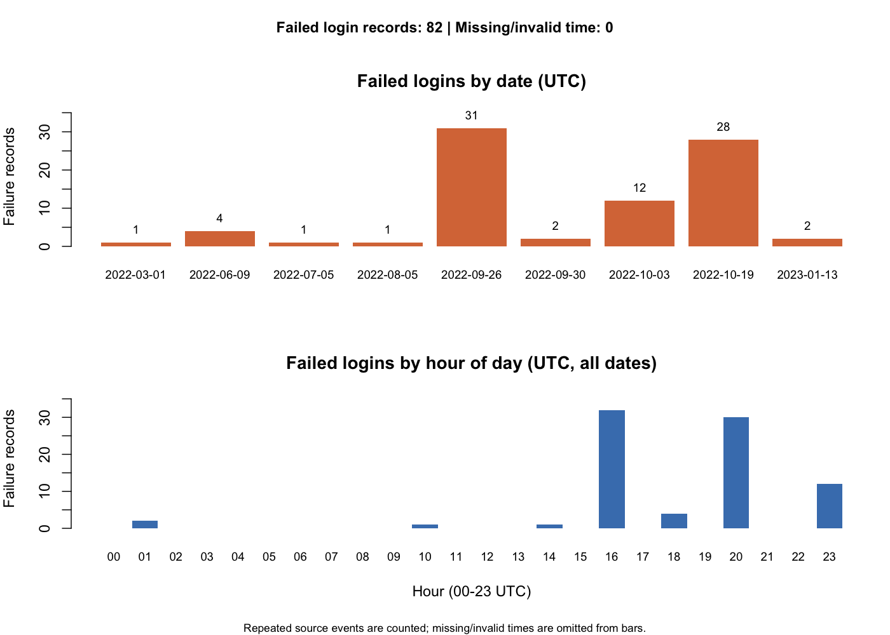

# CloudTrail 로그인 기록 추출과 실패 시각화

CloudTrail JSON에서 ConsoleLogin 이벤트만 골라 시간·사용자·IP·성공/실패를 CSV로 저장하고, 실패 기록을 UTC 날짜별·시간대별 그래프로 보여 주는 R 프로젝트입니다.

## 설명 자료

- [함수·조건문·반복문 상세 요약본](https://p2terghks.github.io/study-notes/cloudtrail-analysis/cloudtrail-function-summary.html)
- [상세 요약본 Markdown](FUNCTION_SUMMARY.md)


## 코드 구성

| 파일 | 줄 수(주석·빈 줄 포함) | 역할 |
| --- | --- | --- |
| login_records.R | 73 | 파일 읽기·JSON 해석·로그인 선택·네 열로 변환 |
| failure_charts.R | 48 | 실패 집계·RStudio 그래프·PNG 저장 |
| run_analysis.R | 14 | CSV와 PNG를 한 번에 생성 |
| 합계 | 135 | 테스트와 설명 문서 별도 |

## 실행

R과 jsonlite가 필요합니다. RStudio 작업 폴더를 이 폴더로 맞추고 입력 파일을 준비하세요. 아래 data/logs.json은 사용자가 준비할 경로 예시입니다.

```r
install.packages("jsonlite")  # 최초 한 번
source("login_records.R")
source("failure_charts.R")
records <- login_records(read_events("data/logs.json"))
View(records)
plot_login_failures(records)
save_failure_chart(records, "output/login_failures.png")
```

터미널에서 CSV와 PNG를 함께 저장하려면 프로젝트 폴더에서 실행합니다.

```sh
Rscript run_analysis.R data/logs.json output
```

결과: output/login_records.csv와 output/login_failures.png. 추출만 실행할 때는 `Rscript login_records.R data/logs.json output/login_records.csv`를 사용합니다. 입력과 출력은 서로 다른 경로로 지정하세요. 기존 출력 파일은 덮어씁니다.

## 처리 기준

Records 문서·이벤트 배열·단일 이벤트·NDJSON을 지원합니다. 사용자명이 없으면 ARN으로 대체하고, 누락 필드는 CSV 빈칸으로 저장합니다. 로그인 이벤트가 없으면 헤더만 저장합니다. 성공과 실패 모두 CSV에 포함하지만 그래프는 result가 정확히 Failure인 행만 셉니다.

중복 기록은 제거하지 않습니다. 실패 시각이 없거나 해석되지 않으면 막대에서 제외하고 제목에 제외 건수를 표시합니다. 날짜 그래프는 실패가 있었던 날짜만 같은 간격으로 표시하고, 시간대 그래프는 모든 날짜의 같은 UTC 시간을 합칩니다.

## 확인한 결과

공개 Splunk 보안 테스트 로그 6개를 합친 로그인 90건에서 실패 82건·성공 8건을 확인했습니다. 별도의 eventID 중복 제거 입력은 43건(실패 39건·성공 4건)입니다. 사용자의 운영 로그가 아니며 공격 판정 정확도를 평가한 결과도 아닙니다. [원본 6개 링크와 해석 기준](FUNCTION_SUMMARY.md#원본-출처)을 함께 확인하세요.



## 그래프 오류 해결

RStudio에서 발생했던 figure margins too large 오류는 두 그래프의 여백이 창 높이보다 커서 발생했습니다. 현재 코드는 5인치 미만 장치에서 여백 단위와 글자 크기를 줄입니다. 수정 파일을 다시 source한 뒤 실행하세요. 아주 작은 창은 Plots를 넓히거나 Zoom을 사용합니다.

```r
# 필요한 기존 그래프를 저장한 후 초기화
# graphics.off()는 열려 있는 그래프 장치를 모두 닫습니다.
graphics.off()
source("failure_charts.R")
plot_login_failures(records)
```

Source로 함수만 불러오면 그래프가 자동으로 나오지 않습니다. plot_login_failures(records)를 호출해야 합니다. run_analysis.R는 터미널 인자를 받는 실행 파일이므로 RStudio에서는 위 함수 호출 예시를 사용하세요.

## 검증

```sh
Rscript tests/test_login_records.R
Rscript tests/test_failure_charts.R
```

입력 형식·누락 필드·정렬·오류 처리·UTC 날짜 및 24시간대·소수점 초·빈 결과·PNG 생성·작은 그래프 장치의 여백 오류를 검사합니다. RStudio에서도 공개 테스트 로그의 날짜별·시간대별 그래프 표시를 확인했습니다.

## 범위와 한계

AWS에서 직접 로그를 수집하지 않습니다. 전체 파일을 메모리에 읽습니다. 원본 시각 문자열 정렬은 동일한 UTC ISO 형식을 전제로 합니다. 실패 기록을 고르는 기능이며 공격 여부를 판정하는 모델은 없습니다. 개별 사용자·IP가 있는 원본 로그와 CSV는 저장소에 포함하지 않고 집계 그림만 예시로 제공합니다.
