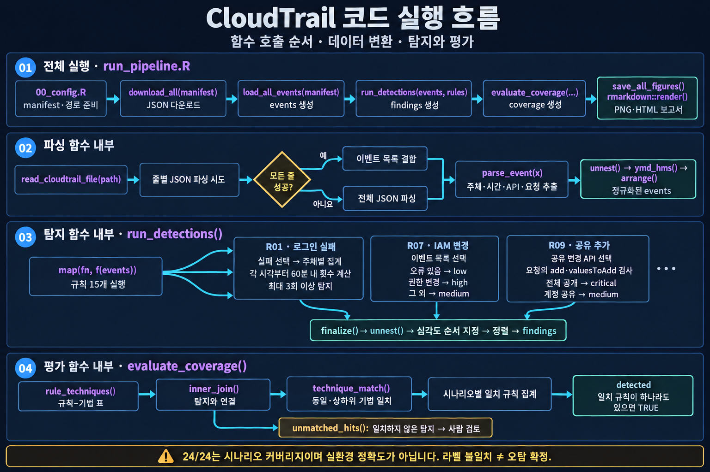

# CloudTrail 공개 데이터 기반 위협 탐지 분석 (R)

공개된 AWS CloudTrail 공격 시뮬레이션 로그를 R로 파싱하고, **규칙 기반 탐지 15개**를 작성해 MITRE ATT&CK 라벨 대비 검증하는 프로젝트입니다. 정상 로그가 없어도 시작할 수 있도록 공개 데이터셋만 사용합니다.



## 무엇을 하나

1. **다운로드**: [Splunk attack_data](https://github.com/splunk/attack_data)의 AWS 시나리오 24종(MITRE 기법 ID 라벨 포함)을 받는다.
2. **파싱**: CloudTrail JSON(한 줄당 이벤트 하나 또는 `{"Records": [...]}`)을 정규화된 표로 바꾼다.
3. **탐지**: 로그인 실패 반복, MFA 없는 로그인, 로깅 무력화, IAM 권한 상승, AMI/스냅샷 외부 공유 등 규칙 15개를 실행한다.
4. **채점**: 시나리오의 정답 라벨과 비교해 규칙이 맞게 발동했는지, 라벨 밖에서 발동한 것은 무엇인지 본다.
5. **리포트**: 차트와 표를 담은 HTML 리포트(`output/report.html`)를 만든다.

## 실행

```bash
# R >= 4.1 필요. 패키지: tidyverse, jsonlite, rmarkdown (pandoc 필요)
Rscript run_pipeline.R        # 프로젝트 루트에서 실행
```

개별 단계는 `Rscript R/01_download.R`, `R/02_parse.R`, `R/03_detect.R`, `R/04_visualize.R`로 따로 돌릴 수 있습니다.
한글이 깨지면 UTF-8 로케일에서 실행하세요 (`LANG=C.UTF-8` 또는 `en_US.UTF-8`).

Docker로 실행 (Dockerfile은 아직 실행해 보지 않았습니다): `docker build -t ct-analysis . && docker run --rm -v "$PWD/output:/app/output" ct-analysis`

## 구조

```
R/00_config.R      데이터셋 목록(manifest), 경로
R/01_download.R    다운로드 (Git LFS 포인터 감지 포함)
R/02_parse.R       CloudTrail 파싱
R/03_detect.R      탐지 규칙 15개 + 라벨 대비 채점
R/04_visualize.R   ggplot2 차트
report.Rmd         HTML 리포트
run_pipeline.R     전체 실행
output/            findings.csv, coverage.csv, figures/, report.html
```

## 결과를 읽을 때 주의할 점

- 규칙은 이 샘플 데이터를 보며 작성했습니다. 그래서 라벨 일치율이 높게 나오지만 **실환경 탐지 성능이 아닙니다.**
- 정상 트래픽이 없어 **오탐률은 측정하지 못했습니다.** `R04`(루트 활동), `R07`(IAM 변경) 같은 규칙은 실제 운영 로그에서 정상 관리 작업에도 발동합니다.
- 규칙은 이벤트 필드만 사용하고 정답 라벨은 채점에만 씁니다 (데이터 누수 방지).
- 라벨은 데이터 제작자의 분류이며 ATT&CK 매핑에 이견이 있을 수 있습니다.
- 임계값(3회, 60분, 10분 등)은 통계적 근거 없이 정한 값입니다.

## 다음 단계

- 본인 AWS 계정의 CloudTrail Event history로 정상 baseline을 만들어 오탐률 측정
- `renv`로 패키지 버전 고정, Shiny 대시보드화, AWS 배포
- 규칙을 Sigma 형식으로 변환

## 데이터 출처

Splunk Threat Research Team의 [attack_data](https://github.com/splunk/attack_data). 데이터의 라이선스와 사용 조건은 해당 저장소를 확인하세요. 이 저장소에는 원본 데이터를 포함하지 않으며 실행 시 내려받습니다.

## 코드 해설과 발표자료

- [핵심 요약본](https://p2terghks.github.io/study-notes/cloudtrail-analysis/cloudtrail-summary.html)
- [클릭형 코드 흐름도](https://p2terghks.github.io/study-notes/cloudtrail-analysis/cloudtrail-interactive-diagram.html)
- [상세 코드 해설서](https://p2terghks.github.io/study-notes/cloudtrail-analysis/cloudtrail-code-guide.html)

이 공개 사본에는 원본 로그와 이벤트별 분석 결과(output/ CSV·HTML·차트)를 포함하지 않았습니다. 설명용 함수 흐름도와 집계 수치만 포함합니다. 실행 후 output/ 결과가 생성됩니다. R 코드 605줄(빈 줄·주석 포함), 보고서 원본·Dockerfile 포함 731줄입니다. 해설은 정적 분석이며 실행 검증을 뜻하지 않습니다.
